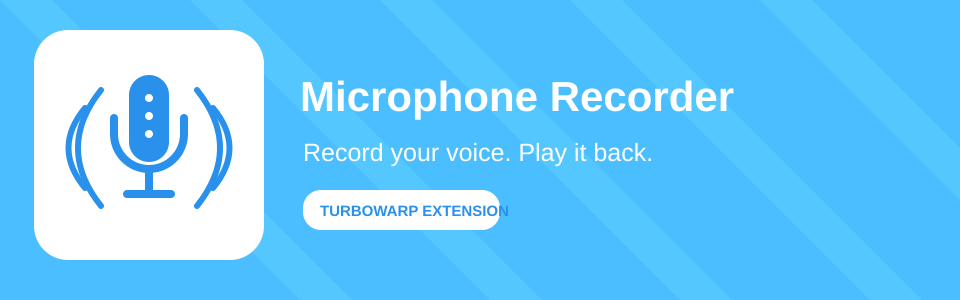

# Microphone Recorder for TurboWarp

Record audio from your microphone, watch a live waveform, and play back your latest take. The extension uses a polished purple recording panel and Scratch-inspired blocks.

## Title and description

**Title:** Microphone Recorder

**Description:** Record audio from your microphone and play back your latest take in TurboWarp.

## Visual assets

The `assets/` folder contains the banner, palette/block icon exports, and
editable SVG sources. The extension embeds its matching purple waveform icon as a data URI so it
still appears when `recorder.js` is loaded from a direct URL.

## Use

Load `recorder.js` as an unsandboxed TurboWarp extension. The extension requests
microphone permission when **start microphone recording** or **request microphone permission** is run. Browsers generally require a user action, so the prompt cannot reliably be triggered just by adding the extension. Browser
permission prompts and audio recording support depend on the browser and the
page's security context (HTTPS or localhost is generally required).

## Customize it

Most common changes are grouped near the top of `recorder.js` in the
`CONFIG` object:

| Setting | What it changes |
| --- | --- |
| `extensionName` | Extension name shown in the palette |
| `extensionDescription` | Short user-facing description for documentation and listings |
| `blockIconURI`, `menuIconURI` | Icon drawn on blocks and in the category palette |
| `extensionColor`, `extensionColorDark`, `extensionColorDarker` | Block colors |
| `overlayTop`, `overlayZIndex`, `overlayBackground`, `overlayBorder`, `overlayGlow` | Recording panel position and appearance |
| `preferredMimeTypes` | Order of audio formats to try when the browser supports them |

The main class is split into small methods so it is easier to modify:

- `getInfo()` — extension metadata and block labels.
- `getSupportedMimeType()` — browser-compatible audio format selection.
- `startRecording()` / `stopRecording()` — microphone lifecycle.
- `saveFinishedRecording()` — finalizes audio and releases the microphone.
- `playLastRecording()` / `stopPlayback()` — playback controls.
- `requestMicrophonePermission()` — explicit permission request from a user-run block.
- `isRecording()` — Boolean reporter for active microphone capture.
- `saveLastRecordingAsSound()` — converts the last take to WAV and adds it to the current sprite's Sounds list.
- `addStageOverlay()` / `removeStageOverlay()` — recording panel lifecycle.
- `startWaveform()` — draws a live microphone waveform using the Web Audio analyser when available.
- `showError()` / `getErrorMessage()` — user-facing error reporting.

### Guidelines for contributors and AI coding tools

1. Keep UI, recording, and playback logic in their existing focused methods.
2. Put commonly customized values in `CONFIG` rather than scattering literals.
3. Preserve microphone-track cleanup on success and failure.
4. When changing recorded audio storage, also manage its object URL with
   `URL.revokeObjectURL()` to avoid retaining browser resources.
5. Do not describe the overlay meter as a hard recording limit unless you add
   and test actual stop-after-duration logic.
6. The waveform is visual feedback and does not cap recording duration. Long
   recordings can still use substantial memory and browser resources.
7. Saving audio requires the extension to run unsandboxed in TurboWarp. Sounds
   belong to sprites; the Stage/backdrop cannot own sounds.

## License

This project is licensed under Creative Commons Attribution-NonCommercial 4.0
International (CC BY-NC 4.0). See [LICENSE](LICENSE). Non-commercial use only;
preserve attribution and indicate modifications.
